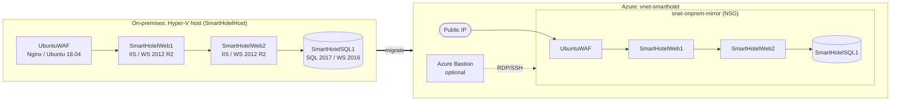

# 0. Architecture

## Before and after

## Design decisions

| Decision | Reason |
|---|---|
| Keep on-prem IPs in Azure | App and proxy configs reference IPs, so nothing needs editing at cutover |
| One subnet + NSG rules per flow | Reproduces the flat LAN while still restricting each tier |
| Only the WAF has a public IP | Same exposure as on-premises |
| Bastion instead of public RDP | No management ports on the internet. Enable it only while administering |
| Storage account for VHDs | Landing area for the manual path. Delete it after migration |

## Traffic rules (NSG)

| Priority | Rule | Source | Destination | Ports |
|---|---|---|---|---|
| 100 | Internet to WAF | Internet | UbuntuWAF | 80, 443 |
| 110 | Bastion admin | Bastion subnet | Workload subnet | 22, 3389 |
| 130 | WAF to Web1 | UbuntuWAF | Web1 | 80, 443 |
| 140 | Web1 to Web2 | Web1 | Web2 | 80, 443 |
| 150 | Web2 to SQL | Web2 | SQL1 | 1433 |
| 4000 | Deny other intra-subnet | Subnet | Subnet | any |

Adjust these to match what dependency analysis (guide 01) shows.
